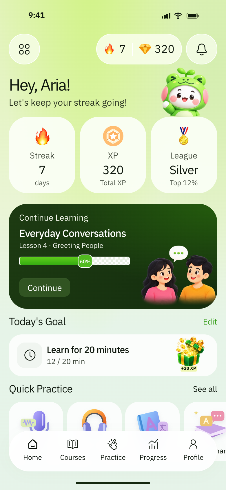

# Lane — Design guide

Accepted direction: October 6, 2026. Applies to Claude Code, Codex, and anyone designing Lane.

## 1. Authority and reference

Use the green home screen in `src/home/` as the visual baseline for future design work. The user approved extending this direction across the app. This replaces the earlier indigo/red palette, editorial typography, and square-control direction for new designs.

Read this file together with `CLAUDE.md` (`AGENTS.md` links to it). This file governs visual decisions; `CLAUDE.md` governs product behavior, content accuracy, architecture, and scope. A visual reference does not authorize adding features or changing learning rules.

**When starting a UI task:** read this guide, inspect the current home screen, and identify which existing components fit the task before inventing new ones.



The image is a saved browser screenshot of the implemented screen at a 390 × 844 CSS-pixel viewport, rendered at 2× resolution. It is a durable visual reference, not a live progress snapshot.

| Reference | Location |
| --- | --- |
| Live home view | `/` or `#/home` while the app is running |
| Markup and preview interactions | `src/home/home.ts` |
| Exact implemented styling | `src/home/home.css` |
| Home copy | `src/home/content.ts` |
| Shared tab navigation and blank pages | `src/home/tabs.ts` |
| SVG icons and practice illustrations | `src/home/icons.ts`, `src/home/home.ts`, `src/home/artwork.ts` |
| Generated character and reward artwork | `public/images/home/` |
| Artwork provenance and prompts | `src/home/ARTWORK.md` |
| Saved accepted screenshot | `docs/design/home-reference.png` |

The home screen is now the **app entry point with working navigation**. Home / Feed / Practice / Progress / Profile are the accepted tabs. Feed opens the existing scrolling lessons; Practice, Progress, and Profile are intentionally blank pages with navigation. Continue opens Feed, and the quick-practice shortcuts open Practice. The saved reference image predates this integration and still shows the original “Courses” label.

Home now shows real XP, streak, and lesson completion through the progress store. The primary action resumes the first unfinished lesson; after all lessons it opens Practice. Native HTML progress bars replace the checkerboard track. Goal editing saves an XP target, and saved-lesson and topic pickers open existing lessons. Sample names, gems, league, fake rewards, notification previews, and fake device chrome have been removed. The saved screenshot remains the original visual reference.

The feed and its quiz sheets now use the home palette and rounded controls. The lesson-summary screen (`#/lesson-progress`) and simulator still have older styling. The new Progress tab (`#/progress`) is blank by request. Restyle or fill these screens when the task calls for it; this guide is not permission to rewrite them all at once.

## 2. Visual character

Lane should feel like a cheerful learning app that a teen would open voluntarily: soft, fresh, playful, readable, and encouraging.

The identity comes from five recurring choices:

1. A pale lime glow at the top of a mint page.
2. Generously rounded, nearly white surfaces with little visible shadow.
3. One deep forest-green focal panel for the next useful action.
4. Regular-weight, friendly sans-serif text with clear hierarchy.
5. Small, colorful illustrations that make learning and progress feel rewarding.

Keep the structure calm even when the artwork is playful. Let typography, spacing, and the contrast between pale surfaces and dark green establish hierarchy. Leave room around content rather than filling every available space.

The design is phone-first. On a wide screen, retain the compact, centered app surface unless a task explicitly calls for a wider layout.

## 3. Color system

These values come from the implemented home screen. Hex colors with eight digits include alpha; their appearance depends on the surface behind them.

| Role | Reference value | Use |
| --- | --- | --- |
| Main ink | `#111A10` | Headings, important values, ordinary text |
| Supporting ink | `#2E3825` | Introductory/supporting copy |
| Muted labels | `#495143`, `#545C50` | Stat labels and secondary details |
| Page, upper lime | `#E1F3B6` | Upper page background |
| Page, transition | `#EAF5D5` | Middle of the background |
| Page, mint | `#E6F4E8`, `#E6F3E9` | Lower page background |
| Lime glow | `#D1F385` | Broad top background glow |
| Secondary glow | `#D5EEB0` | Soft upper-right glow |
| Stat surface | `#FBFFF6EF` | Soft white metric cards |
| General card surface | `#FFFFFFD4` | Goal rows and comparable cards |
| Quiet icon tile | `#F0F5F0` | Background behind a line icon |
| Navigation surface | `#FFFFFFED` | Floating bottom navigation |
| Hero green | `#1D3B12` → `#142D0E` | Primary learning panel |
| Hero glow | `#245C0D` | Subtle green lift in the hero corner |
| Button on hero | `#315422` | Contained action on a dark panel |
| Solid action green | `#244F17` | Primary button on a light surface |
| Progress green | `#5DCC1B` → `#36AC12` | Progress fill |
| Progress badge | `#51BB20` | Small completion marker |
| Light-panel link accent | `#399F1D` | Reference “Edit” accent |
| Focus ring | `#348D19` | Visible keyboard focus |
| Preview surround | `#DFE9DF` | Area outside the centered phone surface |

Use the accent green sparingly. The page and surfaces remain pale; dark green anchors the action. Gold/orange, pink, blue, and lavender belong mainly to artwork and rewards, not to unrelated competing UI themes.

### Background recipe

The broad, low-contrast gradient is part of the accepted design. Preserve its softness:

```css
background:
  radial-gradient(ellipse at 40% -10%, #d1f385 0, transparent 48%),
  radial-gradient(ellipse at 95% 12%, #d5eeb0 0, transparent 34%),
  linear-gradient(
    #e1f3b6 0%,
    #eaf5d5 39%,
    #e6f4e8 62%,
    #e6f3e9 100%
  );
```

For long reading, tests, and dense settings, use a quieter mint background with the glow confined to the header. Do not repeat a bright gradient inside every card.

### Semantic colors

The prototype does not define a complete error, warning, loading, or disabled palette. When those states are needed, use green for successful completion, a restrained amber for caution, and a muted red for a wrong answer or error. Check readability on the actual surface and pair the color with an icon and clear text. Do not use traffic-signal colors decoratively in a way that could confuse driving instruction.

Use a darker green for small action text when the reference's bright accent is too faint. Legibility takes priority over exact color matching.

## 4. Typography

Use the existing self-hosted **IBM Plex Sans**, registered as `Plex`, with `Arial, sans-serif` fallbacks. Keep its font license in `public/fonts/ibm-plex-OFL.txt`. Do not introduce a font dependency to approximate a slightly different reference face.

Use weight 400 for ordinary text, section headings, and most values; use 500 for card titles and meaningful emphasis. Weight 600 is occasional emphasis. Avoid making every title bold.

The home screen uses a local scale of `clamp(13px, 3.7594vw, 16.165px)`. At 390px wide, one local `em` is approximately 14.7px. The measurements below describe that reference, not minimum accessible text sizes for every future screen.

| Role | Home reference at 390px | Guidance for new screens |
| --- | --- | --- |
| Greeting / page heading | `1.9em`, about 28px, weight 400 | Usually 28–32px; sentence case |
| Section heading | `1.23em`, about 18px, weight 400 | Usually 18–22px |
| Featured card title | `1.21em`, about 18px, weight 500 | Usually 18–20px |
| Stat value | `1.42em`, about 21px, weight 400 | Keep values stronger than their labels |
| Supporting greeting | `1.09em`, about 16px | Comfortable everyday reading size |
| Body / stat label | `1em`, about 15px | Aim for 16px for sustained reading |
| Metadata | `.83–.87em`, about 12–13px | Keep secondary; do not hide required instructions here |
| Navigation label | `.82em`, about 12px | Visible text below each icon |

Use a line height near 1.3 for compact UI and 1.45–1.6 for explanations and longer text. Keep tight tracking limited to large headings and short titles; do not apply it to paragraphs.

Use Plex Sans for the new app chrome. The older Plex Condensed poster titles and Plex Mono labels are not the new default. Existing lesson posters can keep their own treatment until explicitly redesigned.

The prototype's tiny reward/percentage labels are illustration details. For future functional labels, aim for at least 12px, and expose the underlying value as readable text or an accessible label. Do not scale the whole UI down just to fit more information.

## 5. Layout, spacing, and shape

### Screen shell

- Baseline phone viewport: **390 × 844**. Also inspect **320 × 740** and **844 × 390**.
- Center the ordinary app surface at `width: min(100%, 430px)`.
- Use approximately **16px page gutters**, growing to about 17px at the maximum width.
- Let the content scroll vertically. Do not freeze a long screen to the reference's height.
- Reserve enough bottom space to scroll the last item fully above floating navigation. The home reference uses `6.7em`, about 98px, of bottom content padding.
- Respect `env(safe-area-inset-*)` and `100dvh`; retain hash routes and existing offline behavior.
- On desktop, keep the centered mobile composition. Its optional rounded outer corners are preview framing, not an instruction to draw a phone bezel on every screen.

### Spacing rhythm

Use a small consistent scale: **4, 8, 12, 16, 20, 24, 32px**. Approximate the reference's geometry where useful; do not force every measured value onto this scale.

| Relationship | Home reference |
| --- | --- |
| Gap between metric cards | `.5em`, about 7px |
| Gap before featured learning panel | `1.2em`, about 18px |
| Featured panel inner horizontal padding | `1.2em`, about 18px |
| Section-heading row | `3em`, about 44px tall |
| Gap between quick-practice tiles | `.45em`, about 7px |

Use wider spacing between sections than between related content inside a card. Keep headings and their actions aligned on one row when they fit; allow wrapping when they do not.

### Corner radii

| Shape | Home reference / extension |
| --- | --- |
| Stat cards | `2.25em`, about 33px |
| Featured learning panel | `2.2em`, about 32px |
| Compact goal row | `1.55em`, about 23px |
| Quick-practice tiles | `1.6em`, about 23px |
| Floating navigation | `2.4em`, about 35px; pill-like |
| Buttons | About 10–14px; larger radii for larger controls |
| Icon tiles | About 14px |
| Circular toolbar controls | Fully round |
| Sheets and dialogs | About 24–28px; round the sheet's upper corners |

Large cards have visibly soft corners. Do not make every component a pill: buttons, answer choices, and compact rows still need distinct silhouettes.

### Borders and depth

Use surface color and spacing before adding borders. Where separation is needed, use a thin pale border or a restrained green-tinted outline. Avoid thick black strokes around cards.

Shadows are nearly invisible: the reference navigation uses `0 4px 24px #3e642607`. Small illustrations can have a soft grounding shadow. Avoid floating every card on a dark shadow.

The navigation uses a lightly translucent surface and `backdrop-filter: blur(14px)`. Its background must remain readable if blur is unavailable; do not make blur essential to the design.

## 6. Component patterns

### Header and greeting

Use a compact top row with circular utility controls and, when real data is available, a compact progress pill. Below it, put one friendly heading and a short supporting sentence. A mascot may sit to the right and overlap the next surface slightly.

The mascot is secondary to the greeting. Keep it clear of text, shrink or move it for long names, and allow the heading to wrap. The frog costume is the current visual reference; a final Lane mascot identity has not been established by this screen.

### Metric cards

Use the home screen's three-card strip when there are three useful, real metrics. Each card has: illustration, label, value, and a short qualifier. Center the content and keep the order consistent.

The reference cards are about 130px tall. Their layout works because the labels are short. Allow larger cards or wrapping for longer content. Do not add empty league, currency, or ranking features to fill the strip.

### Featured learning panel

Use one full-width dark green panel for the strongest next action. Its hierarchy is:

1. A small context label, such as “Continue learning.”
2. A specific lesson or task title.
3. One short line of metadata.
4. A visible progress indicator when meaningful.
5. One clear action button.
6. Supporting artwork near the lower right.

The home panel is about 178px tall. Treat that as a reference, not a fixed height: long titles and larger text must increase the card's height. Keep the illustration out of the title, progress track, and action hit area.

### Buttons and text actions

- On a light surface, use a solid forest-green primary button with light text.
- On a dark panel, use the lighter contained green button from the reference.
- Use a quiet pale surface or thin outline for a secondary button.
- Use a text action for low-emphasis contextual actions such as “Edit” or “See all.”
- Prefer concise verb labels: “Continue,” “Start test,” “Review,” “Try again.”
- Show pressed, focus, loading, and disabled states. A disabled action needs an understandable reason when it affects the next step.
- Keep actual touch targets at least **44 × 44px**, including icon-only and text actions. The reference's compact Continue button is smaller; enlarge its target when turning the prototype into a functional product.

### Progress and rewards

Use a bright green fill inside a light track, with a small marker if the exact percentage helps. The home track has a subtle white/pale checker pattern; quieter tracks are appropriate in tests and dense progress views.

Show actual progress. Watching a clip, completing a quiz, and mastering a topic are different states; the design must not collapse them into an invented mastery percentage. Keep the marker inside the track at 0% and 100%.

Rewards can use small gold coins, a gift, or a medal. Show earned rewards only after the store records them. A decorative gift does not establish a new currency or reward system.

### Goal and compact information rows

Use a light rounded horizontal surface with a quiet icon tile on the left, a title and short detail in the middle, and optional supporting artwork or an action on the right. Keep the detail aligned with the title, not centered under the entire card.

The home goal row is about 72px tall. It may grow when content wraps. Use this pattern for review reminders, short summaries, and settings that need a single action.

### Quick-practice tiles

Use small rounded tiles in a horizontal scroller, with one colorful illustration and a short label. The home tiles are about 94px wide and 103px tall. A partially visible next tile can signal horizontal scrolling.

Use this for a handful of optional practice choices. Larger libraries need a readable list or grouped units, not an endless carousel. Every tile must become fully reachable above the navigation, including through keyboard focus.

### Bottom navigation

Reuse the floating pale pill, evenly spaced outline icons, and visible labels. Mark the active destination with a stronger icon stroke and darker text; expose the current destination semantically.

The reference is about 70px tall and inset by the page gutters. The current destinations are **Home / Feed / Practice / Progress / Profile**, shared by Home and the three blank pages. Keep the selected tab marked with `aria-current="page"`. The full-screen Feed has a visible Home return control. Keep Practice, Progress, and Profile empty until their features are requested.

Hide app-level navigation during full-screen video and simulator use, as required by the learning flow. Avoid covering actions or explanations with the floating bar.

### Minimal scrolling feed

Keep the media edge to edge, with no dashboard, lesson badges, XP/streak counters, captions, social counts, or persistent playback controls. The only persistent text over a lesson is its title at bottom left and a small top-right timer labeled “Since you've been scrolling.” A quiet back arrow at top left returns Home; the app tab bar stays hidden.

The right-hand action rail has exactly three icon-only controls: **like, bookmark, share**, in that order. Use 48px pale rounded targets, forest-green outlines, and a filled green state for liked/saved lessons. Persist likes and saves through the existing progress store. Do not invent engagement counts. Share opens the native share sheet where available, with a copied-link fallback.

Tapping the media pauses/resumes it; only paused media shows a centered play icon. Swipe vertically to change lessons. The timer counts visible time in the current feed visit, including pauses and quiz answers, continues across lessons, excludes hidden-tab time, and resets when the user leaves and returns.

Current media is a decorative green road poster (`src/feed/poster.ts`), not real footage or a demonstration of each lesson's answer. Its gentle motion stops when paused and respects reduced motion. Replace it with licensed lesson videos when available. On actual footage, keep the footage's colors, use a white bottom title over a soft legibility shade, and retain pale/green utility controls.

The minimal-text rule applies to the scrolling media view; quiz questions and feedback still appear in a rounded pale-green sheet when the lesson ends. Keep existing learning behavior intact. Feed-specific overrides live in `src/feed/minimal.css`; do not recolor the simulator or legacy summary as a side effect.

### Sheets and dialogs

Use a soft light surface, rounded upper corners for bottom sheets, dark text, clear heading, and generous answer/action spacing. A subdued green-black scrim separates the sheet from the background.

Keep the lesson visible behind an on-video quiz. Sheets must handle focus, dismissal rules, scrolling, and safe areas according to the actual learning flow. Do not introduce a dismiss action where the flow requires an answer or a recovery step.

## 7. Applying the style to other screens

The following are design directions, **not claims that these screens or features have been built**.

| Screen / flow | Extend the home style this way | Preserve |
| --- | --- | --- |
| Lesson feed | Keep video dominant; use quiet light utility controls and rounded overlays, with green for relevant actions | Vertical swipe behavior, real video-ended quiz trigger, poster fallback |
| Quiz sheet | Light rounded sheet, readable question, full-width rounded answer rows, dark green primary action | Same-screen check, accurate answers, required correction/recovery flow |
| Wrong-answer feedback | Calm explanation panel, icon plus text, one useful next action | Supportive tone; a similar follow-up question when required |
| Mock permit test | Quiet mint background, clear question count, readable answer rows, restrained progress track | The separate question bank and scoring rules when implemented |
| Test result | One outcome summary and clear review actions; small celebratory artwork only when justified | Honest score, weak-topic recovery, no fabricated readiness claims |
| Progress | Rounded metric cards, simple green weekly bars, grouped review/topics, one useful next step | Real XP, streak, daily totals, and review state from the progress store |
| Daily review | Focused list or one-question-at-a-time flow using the same answer/card patterns | Review timing, skipped material, and weak-topic selection |
| Simulator | Apply rounded readable controls and the green/pale UI palette to the HUD; leave the road scene visually clear | Babylon rendering, traffic-signal meaning, braking/replay controls, optional practice |
| Onboarding / sign-in | Short steps, readable inputs, one main action, optional small mascot | Planned required sign-in and minimal-data account requirements |
| Settings / future profile | Simple grouped light rows; reserve artwork for meaningful empty or success states | Only fields and settings the implemented product supports |

Adapt density to the task. The home screen welcomes and motivates; a quiz must help the learner read and decide; simulator controls must remain understandable at a glance. Shared colors and shapes matter more than repeating the home card stack verbatim.

## 8. Illustration and icon rules

Use two complementary styles:

- **Controls:** thin outline SVG icons, rounded caps/joins, typically a 24 × 24 view box with stroke width 1.5. Active navigation can use a stroke around 2.1. Keep icon weight consistent across a control group.
- **Learning/reward artwork:** colorful, rounded objects or characters with gentle 3D shading, soft lighting, transparent backgrounds, and friendly expressions.

Reuse the existing home assets first. Keep characters, scale, shading, and palette consistent when making more. Do not generate a new mascot for each screen. The source conversation illustration is language-learning sample art; future driving lessons need relevant artwork without obscuring actual instructional evidence.

Use SVG or existing code-native graphics for simple controls. Use raster artwork for characters and richer scenes. Preserve aspect ratios and transparency. Do not stretch illustrations, add a white rectangle behind a cutout, or use artwork as the sole explanation of a driving rule.

Flame and medal currently use platform emoji and will vary by operating system. That is a prototype detail, not a requirement for all future graphics. Prefer a consistent owned icon/asset when cross-platform fidelity matters.

Keep assets self-hosted, record generated-image prompts or external source/license details, and check file weight. Size and compress future raster assets for their rendered use before shipping; keep the simulator lazy-loaded. Do not add an icon or animation package just to reproduce this style.

## 9. Motion, feedback, and tone

Use small motions with a purpose: a 1px press response, a short sheet transition, or a brief success cue. For new transitions, start around 150–250ms; a sheet may take around 250–350ms. These are extension defaults, not existing home animations.

Honor reduced-motion preferences. Avoid perpetual mascot bouncing, pulsing navigation, constant floating coins, and confetti on every answer. Keep feedback understandable when motion is disabled.

Use warm, direct English. Sentence case is the default. Explain what the learner can do next. Follow the supportive correction wording and content requirements in `CLAUDE.md`.

Do not invent streaks, scores, nicknames, or encouragement based on data the app does not have. Use an honest empty state such as “Your progress starts with your first lesson,” with a clear action.

## 10. Accessibility and responsive behavior

- Aim for text contrast of at least 4.5:1 for ordinary text and 3:1 for large text. Check translucent surfaces against their actual background; token colors alone are insufficient.
- Keep touch targets at least 44px. Preserve visible focus, real buttons/links, labels for icon-only controls, and semantic progress values.
- Do not convey correctness, selection, or warnings with color alone. Add a check, label, explanation, or border change.
- Let content grow with larger text and longer lesson titles. Avoid fixed card heights and illustration overlaps that only work for sample strings.
- Support narrow phones and landscape scrolling. Do not shrink question text to force a one-screen layout.
- Keep focused fields, final list items, and sheet actions clear of floating navigation, safe areas, and the software keyboard.
- Treat decorative illustrations as decorative; give informative graphics meaningful alternatives. Keep instructional text in the DOM rather than embedded in images.
- Preserve accessible media controls and account for captions when real videos are introduced.

Home uses the browser/device’s actual chrome and safe-area spacing. The original reference’s fake status bar and home indicator are no longer rendered. Do not add fake system chrome to production screens.

## 11. Implementation boundaries

Stay with Vite, plain TypeScript, and the existing CSS/DOM approach. This guide does not require a framework, component library, new store, router replacement, or dependency.

Keep visual changes scoped to their screen or component. The simulator stylesheet includes broad selectors; verify returning from the simulator does not change page typography or disable scrolling. The home currently guards its scroll behavior with `body:has(.home-preview)` and scopes its own styles.

The palette and measurements in this file are design specifications. They have **not** been extracted into shared runtime CSS variables. If a task needs shared styles, extract only the pieces it actually reuses, preserving the reference appearance and existing behavior. Do not perform a global CSS rewrite just to create a token system.

Keep user-facing lesson content in data files and escape template-string data. Read and write progress through `src/feed/progress.ts`. A styling change must preserve routes, saved progress, service-worker behavior, video fallback, and simulator handoff.

When replacing prototype content, use real Lane copy and supported metrics. Do not carry over language-learning examples, sample ranks, gems, notification behavior, or the preview dialog as finished functionality.

## 12. Design review and verification

Before calling a UI change done:

1. Compare the result with the saved home reference: soft background, light rounded surfaces, forest-green focus, regular-weight type, gentle illustration style, and sparse depth should still be recognizable.
2. Check the actual task flow, including long copy, empty state, loading/error state, and larger text when relevant. Keep disabled and selected states clear.
3. Run `npm run build` as required by `CLAUDE.md`.
4. Run the walkthrough for the changed UI and **look at its screenshots**. With the production preview server running:
   - Home: `node scripts/inspect-home.mjs`.
   - Feed/quiz/progress: `npm run inspect:feed`.
   - Simulator: `PRODUCTION=1 npm run inspect`.
5. Use `BASE` to point an inspector to the running preview origin, and `CHROMIUM` if the default browser path is unavailable. The scripts write screenshots to ignored `artifacts/`.
6. Check portrait 390 × 844, narrow 320 × 740, and landscape 844 × 390 for the affected screens. The home inspector also covers desktop 1440 × 1000. Do not describe desktop browser emulation as a physical-phone test.
7. Verify offline loading when changing routes, assets, or caching; add the relevant logic checks when changing progress/scoring/review behavior.
8. State what is functional, what is a preview, and what remains unimplemented.

Update this guide and its saved reference when the user accepts a meaningful change to the visual direction. Do not silently replace the reference after an unrelated UI edit. Documentation-only updates need link/content checks and the required build; they do not require replaying all unchanged UI walkthroughs.

## 13. Avoid visual drift

| Keep | Avoid |
| --- | --- |
| Soft lime-to-mint page, restrained forest-green focal area | Harsh neon gradients, unrelated dark themes, a return to the old indigo/red chrome |
| Rounded surfaces with little shadow | Square editorial panels or heavy shadows on every card |
| One obvious next action | Multiple equal-weight primary buttons fighting for attention |
| Regular-weight readable text | All-caps chrome, condensed headings everywhere, tiny functional labels |
| Relevant, consistent illustrations | Random mascots, unrelated emoji decoration, mixed artwork styles |
| Compact mobile composition | Generic desktop dashboard, dense bento layout, arbitrary card grid |
| Honest progress and useful encouragement | Invented ranks/rewards, fake mastery, shame or pressure |
| Existing architecture and learning flow | Rebuilding infrastructure as part of a visual task |
