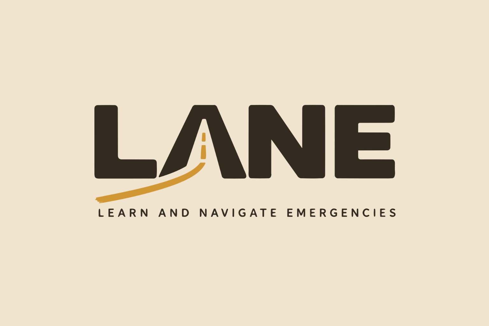

<div align="center">



# 🚗 Lane

**A free, scroll friendly way to actually remember the rules of the road.**

[](LICENSE)
[](https://www.typescriptlang.org/)
[](#why-isnt-this-on-the-app-store)
[](https://www.novato.org/)
[](https://www.congressionalappchallenge.us/)
[](https://www.congressionalappchallenge.us/)

[](package.json)
[](https://supabase.com/)
[](https://www.babylonjs.com/)
[](https://vite.dev/)
[](src/feed/clips.ts)
[](vendor/lane-simulations/)
[](https://github.com/HamzaLovesCoding/CongressionalAppChallengeApp/graphs/contributors)

[](https://laneapp.vercel.app/#/welcome)

</div>

## About

Lane was created for the Congressional App Challenge, 2026. 2<sup>nd</sup> district of California.

Lane is a driving education app for teens who are about to get their permit, are learning to drive, or just want to stay sharp. It looks and feels like the short video apps you already scroll every day, but every swipe teaches you something useful about driving. You watch a short driving lesson, answer a quick check about what you just saw, and the app figures out what you should see next.

[Click here to try Lane in your browser.](https://laneapp.vercel.app/#/welcome) It works best on a phone.

Here is what is inside right now.

* 🎬 **A lesson feed.** 24 lessons you swipe through. 19 of them are real driving videos and 5 are tap the missing word text lessons. Every lesson carries the matching California rule and the exact handbook page it comes from.
* ✅ **Quick checks.** When a video ends, a question opens right over it. Miss it and Lane explains the rule, then asks a similar question instead of the same one.
* 🕹️ **10 driving simulations.** Short 2D and 3D challenges like a yellow light, a four way stop, a freeway entrance and a railroad crossing, where you have a few seconds to make the safe call.
* 🧠 **A learning algorithm we made ourselves.** It looks at how you answer, how much effort you put in, how long you spend and whether you finish a video, then picks your next lesson, a review item or a challenge.
* 📝 **A practice permit test** with 43 California questions and a breakdown by topic.
* 🛣️ **Progress as a highway.** Your car drives down a winding road as you finish lessons and pass milestones.
* 🏁 **Streaks, XP and a garage.** Earn XP from lessons and spend it on collectible cars. Make a group with a code and compete with friends on a weekly leaderboard.
* 🔔 **Reminders inside the app** for your permit test date, your streak, and when a friend passes you.
* 📴 **Works offline.** Install it to your home screen and lessons you have watched keep playing without a connection.

## Congressional App Challenge

Lane was made as an entry for the Congressional App Challenge, a competition that encourages students to learn coding and computer science by building their own apps. The challenge is run by members of the U.S. House of Representatives, and winners are recognized for what they build in their district.

### Why we made it

In 2019, a San Marin High School student died in a crash on Simmons Lane on his 16th birthday. In April 2026, another crash at San Marin Drive and Simmons Lane killed a Rancho Cotate High School student and seriously injured four other teens. Both happened close to our school.

Those crashes made us think about how young drivers actually prepare. Most people study for the permit test once, pass it (or don't), and never look at the rules again. Knowing a rule for a test is very different from remembering it in a stressful moment on the road. We also knew that anything that felt like homework would never get opened. So instead of fighting the scrolling habit, we used it. Lane is the same swipe you already know, just filled with things that might help you make a safer choice someday.

Yes, the name is a little bit of a nod to Simmons Lane. It also stands for **L**earn **A**nd **N**avigate **E**mergencies.

### AI Disclosure

This project was built with the help of AI tools. Specifically, we used **Claude Code** and **OpenAI Codex** as support while we were developing. Everything they helped with was reviewed, tested and changed by us before it stayed in the app.

How we feel about it is pretty simple. AI is a tool that helps you go faster, and it is not the one making the app. It helped us when we were stuck, but we still had to understand every part of Lane, connect it all together, and make the calls about what belonged in it. Driving rules have to be right, so a human (one of us) always had the final say.

<details>
<summary>What was AI used for?</summary>

* Explaining technical approaches when we were unsure how to build something.
* Reviewing parts of our code and logic, and helping test the code near the end.
* Thinking through how a social media style feed and video playback should behave.
* Turning the simulations and quick time events we designed into interactive scenes.
* Checking how our sources were organized after we collected them ourselves.
* Pointing out wording that was inconsistent from one screen to another.
* Double checking our reading of the California DMV handbook with ChatGPT, so our own bias would not slip into the quiz answers.
* Lane also has a **Driver Coach** on the Practice tab that answers driving questions using the California handbook and shows the page it got the answer from. It runs on Claude through a Supabase Edge Function. It is built and tested, but it is not switched on in the live app yet.

</details>

### What did we NOT use AI for?

* Coming up with the idea for Lane.
* Designing the learning flow.
    1. Video, then a quick check, then feedback, then review or a simulation.
    2. Deciding what happens when someone gets an answer wrong.
    3. Deciding when to offer a simulation and when to bring a lesson back for review.
* Creating the formula behind our learning algorithm and choosing what it looks at.
* Writing the quiz questions. We wrote them by hand from California DMV resources.
* Choosing the lesson videos. We tried AI generated videos early on, and they were not good enough to teach driving, so we picked real ones and checked every license.
* The look of the app. Colors, layout, animations and the feed buttons were our call. We looked at DaisyUI, Dribbble and Figma for inspiration, then threw most of it out and copied nothing.
* Deciding what made it into the final app and what did not.
* ... and so on (you get it).

AI shows up in different spots across the codebase, but every piece of it went through us. If it did not match what we wanted, it got rewritten or removed.

## Tech Stack

Lane's tech stack includes:

* **Frontend:** Lane is a web app that you can install on your phone (a PWA).
    * **TypeScript:** The main language for the whole app. No UI framework, just plain TypeScript.
    * **Vite:** Builds and bundles everything, and runs the local dev server.
    * **CSS:** Every screen is styled by hand (with some help from CSSMatic for shadows).
    * **Babylon.js:** Powers the 3D driving simulations, and only loads when you open one so the app stays fast.
    * **A custom service worker:** Lets Lane load and play saved videos offline.
* **Backend:** The server Lane talks to when backup is on.
    * **Supabase:** Postgres database, anonymous accounts and Edge Functions.
    * **PL/pgSQL:** Database functions for XP, leaderboards, code groups and lesson comments.
    * **Row Level Security:** So every learner can only touch their own data.
* **Testing:** Node's built in test runner for our logic, plus Playwright walkthroughs that click through every screen on a bunch of phone sizes.

<details>
<summary>Privacy</summary>

Lane is built for teenagers, so we tried to collect as little as we possibly could.

* Lane never asks for your real name, email, phone number, address or school.
* It does not use your location, camera, microphone or contacts.
* There are no ads, no analytics and no tracking.
* Your progress is saved on your own device first. Backup to our server is optional and uses an anonymous account, not a login.
* The only name anyone else ever sees is the username you pick, on leaderboards and comments. You can delete your own comments whenever you want.
* Likes, saves and the cars you unlock never leave your device.

The full Privacy Policy and Terms are inside the app, under Profile.

</details>

## Why isn't this on the App Store?

Short version: Lane is a web app on purpose, so it works on any phone without going through an app store.

Publishing to the App Store and Google Play costs money every year and goes through a review process, and we wanted anyone (iPhone, Android, a school Chromebook, whatever) to be able to use Lane right away. Since Lane is a PWA, you can add it to your home screen and it opens full screen just like a normal app, even offline. Wrapping it for the app stores is something we might do later.

<details>
<summary>How to add Lane to your home screen</summary>

**iPhone (Safari)**
1. Open Lane in Safari.
2. Tap the Share button.
3. Tap **Add to Home Screen**, then **Add**.

**Android (Chrome)**
1. Open Lane in Chrome.
2. Tap the three dots in the top right corner.
3. Tap **Add to Home screen** or **Install app**.

</details>

## Building from Source

To run Lane on your own computer, follow these steps:

1. Clone the repository:

```bash
git clone https://github.com/HamzaLovesCoding/CongressionalAppChallengeApp.git
cd CongressionalAppChallengeApp
```

2. Install the dependencies (you need [Node.js](https://nodejs.org/) installed):

```bash
npm install
```

3. Start the dev server:

```bash
npm run dev
```

4. Open the link it prints (usually `http://localhost:5173`) in your browser. If you want the real phone experience, open your browser's dev tools and switch to a phone view.

That's it. Without any setup, Lane runs completely on your device and saves progress locally. Leaderboards, groups and comments need a Supabase project. If you have one, copy `.env.example` to `.env.local` and fill in your project URL and publishable key. The steps for setting up the database are in [`supabase/README.md`](supabase/README.md).

... Or, if you just want to build the final app and check the tests pass, you can do that too:

```bash
npm run build
```

```bash
node --test scripts/*.test.mjs
```

The finished build ends up in the `dist` folder.

We built and tested Lane on Node 24, so we would recommend using that.

## Credits

Lane is developed by [Hamza Wadera](https://github.com/HamzaLovesCoding) and [Arnav Lal](https://github.com/cubinghay-lgtm) for the Congressional App Challenge 2026, 2<sup>nd</sup> district of California.

A big thank you to everyone whose work made Lane possible.

* **Lesson videos:** The 19 lesson videos come from the YouTube channels **Trubicars** and **CRUDE Ultimate Driving Education**, used under the [Creative Commons Attribution 3.0](https://creativecommons.org/licenses/by/3.0/) license. We trimmed them and converted them so they play on every phone. Every clip is credited by title and creator on the Credits page inside Lane and in [docs/credits.md](docs/credits.md).
* **Driving rules:** The *California Driver's Handbook* and the *California Quick Reference Driver's Handbook (DL 600X, 2025)* from the California DMV, used under [CC BY-NC 4.0](https://creativecommons.org/licenses/by-nc/4.0/). Lane is not made by or connected to the DMV.
* **Local data:** Novato crash figures come from the California Office of Traffic Safety.
* **Fonts:** IBM Plex Sans and Zilla Slab, under the SIL Open Font License.
* **3D engine:** [Babylon.js](https://github.com/BabylonJS/Babylon.js), under the Apache License 2.0.
* **Testers:** Our classmates and the people online who tried early versions and told us what was confusing. Thank you!

## License

The code we wrote for Lane is open source under the [MIT License](LICENSE). That means you can use it, change it and share it, as long as you keep our names on it.

The MIT License only covers our code. The lesson videos, the DMV handbook text, the fonts and Babylon.js keep their own licenses, listed in Credits above. The handbook text is for non commercial use only, so anyone who wants to use Lane commercially would have to remove or replace it.

## ⚠️ Disclaimer

Lane is **not** a replacement for a driver's education course, a licensed driving instructor, or supervised practice behind the wheel. It is a study and review tool that works alongside them. Lane cannot tell you that you are ready to drive or that you will pass your test.

**Never use Lane while you are driving.** Not at a red light, not in traffic, not ever. Pull over and park first.

For official rules and testing information, always go to the source.

* California DMV: [dmv.ca.gov](https://www.dmv.ca.gov/)
* California Driver's Handbook: [dmv.ca.gov/portal/handbook](https://www.dmv.ca.gov/portal/handbook/california-driver-handbook/)

This software is provided *"as is"* without warranty of any kind. The developers are not responsible for any consequences that come from using it, to the fullest extent allowed by law. See the [LICENSE](LICENSE) file for more information.
